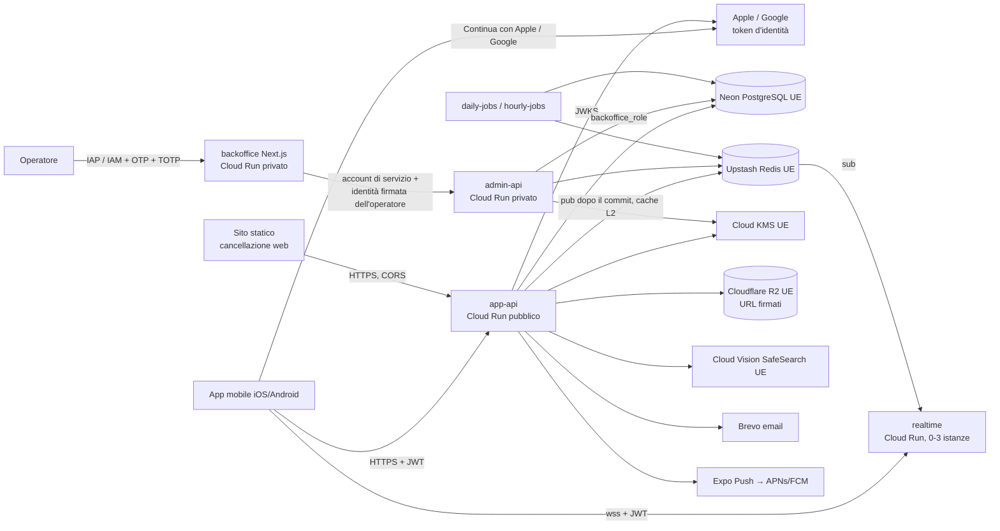

# Swipe & Slide — Backend

Specifica tecnica di riferimento del backend: architettura, tecnologie, sicurezza, prestazioni e
regole di sviluppo. Il repository contiene l'API NestJS, il servizio del tempo reale, i processi
pianificati e il backoffice Next.js.

Legenda:
- **(Dnn)**: decisione già presa sul progetto, non si cambia senza una nuova decisione;
- **[Proposta]**: scelta tecnica non ancora decisa, da confermare prima o durante lo sviluppo;
- nomi del codice in inglese, testi e commenti in italiano (D215).

## Indice

1. [Cos'è](#1-cosè)
2. [Architettura e servizi](#2-architettura-e-servizi)
3. [Stack](#3-stack)
4. [Sicurezza](#4-sicurezza)
5. [Prestazioni ed efficienza](#5-prestazioni-ed-efficienza)
6. [Chat in tempo reale](#6-chat-in-tempo-reale)
7. [Affidabilità e osservabilità](#7-affidabilità-e-osservabilità)
8. [Sviluppo](#8-sviluppo)
9. [Costi](#9-costi)
10. [Stato](#10-stato)

---

## 1. Cos'è

API della dating app **riservata ai consulenti**: registrazione con un'identità personale (Apple,
Google o email personale) e poi con l'email aziendale di una società di consulenza dell'elenco
approvato, profilo approvato a mano dal team, feed, swipe, match, chat, Agenda dei meeting,
Offsite, moderazione e backoffice. App mobile e backend comunicano solo via API (D4); il backend è
l'unico componente che accede al database.

**Regola core: "colleghi, solo se vuoi"**
- Di base due persone della **stessa azienda attuale** non si vedono: niente feed, like, match,
  chat né profilo. Si vedono solo se hanno attivato **entrambe** l'**Open space** (spento di base).
- Le chat già avviate restano anche quando due persone diventano colleghe o una spegne l'Open space;
  un match senza messaggi invece si revoca subito (D58, D59).
- Blocchi, account in sospeso o in approvazione, "Aziende escluse" (reciproche) valgono sempre e
  possono solo ridurre la visibilità.

**Difesa a strati.** La regola ha una sola definizione (funzioni SQL `can_see`, `can_interact`,
`can_write`) applicata da più strati indipendenti, così che un errore in uno strato non basti a
violarla:

| Strato | Dove | Cosa garantisce |
|--------|------|-----------------|
| 0. Identità verificata | Registrazione, cambio azienda, ri-verifica, approvazione | L'azienda di ogni utente viene solo dal dominio dell'email aziendale, verificata con OTP; profilo approvato da una persona (D9, D141) |
| 1. Query del feed | `FeedModule` | Legge solo candidati con visibilità reciproca: gli altri non vengono mai caricati |
| 2. Funzioni e guard | `CoreRuleModule`, `@ExposesUser`, `VisibilityGuard` | Ogni rotta che espone un altro utente dichiara la sua regola (`interact` o `match`) |
| 3. Database | Trigger `check_core_rule`, `check_realignment`, `check_approval`, vincoli, ruoli | Nessuna scrittura vietata passa, anche con un errore nel codice |
| 4. Suite RC | Integrazione continua, PostgreSQL reale | Nessuna modifica che indebolisca la regola arriva su `main` |

Principi trasversali: **nel dubbio si nasconde** (fail closed); **nessuno scopre il motivo**
(stesso `404` per utente inesistente, bloccato, escluso, collega o sospeso); **dati in UE**.

---

## 2. Architettura e servizi

Un solo codice NestJS e **una sola immagine Docker** per API, tempo reale e processi; il backoffice
ha la sua immagine, costruita dalla cartella `backoffice/` dello stesso repository (D116).
Servizi, selezione dei moduli e struttura delle cartelle sono decisi con D231.

| Servizio (Cloud Run) | Accesso | Moduli caricati | Note |
|----------------------|---------|-----------------|------|
| `app-api` | Pubblico (HTTPS) | Solo i moduli dell'app (`src/app/`) e il nucleo | Nessuna rotta di amministrazione nel servizio |
| `admin-api` | Privato (IAM), invocabile solo dall'account di servizio del backoffice | Moduli di amministrazione (`src/admin/`) e il nucleo | Ruolo del database `backoffice_role` (D90) |
| `realtime` | Pubblico (`wss://`) | Gateway WebSocket (`src/realtime/`) | Da 0 a 3 istanze, 1 vCPU, 512 MiB (D182) |
| `daily-jobs`, `hourly-jobs` | Cloud Run job da Cloud Scheduler | Processi pianificati (`src/jobs/`) | `node dist/jobs.js daily` / `hourly` |
| `backoffice` | Privato (IAM o IAP) | Next.js, intermediario lato server (BFF) | Chiama solo `admin-api` con il client generato; **non tocca mai il database** (D92) |



**Selezione dei moduli** (D231): la variabile `SERVICE_ROLE` (`app`, `admin`, `realtime`) sceglie
il modulo radice (`AppApiModule`, `AdminApiModule`, `RealtimeServerModule`); i processi partono da
`src/jobs.ts`. Un controllo statico in CI (dependency-cruiser o regole ESLint sui confini) vieta a
`src/app/` di importare `src/admin/` e viceversa; un test verifica che l'API pubblica non esponga
alcuna rotta `/backoffice/*`.

**Struttura delle cartelle** (D231):

```
swipe-and-slide-backend/
├── src/
│   ├── core/            regola core: CoreRuleModule e CoreRuleService (canSee, canInteract,
│   │                    canWrite, setOpenSpace, realign), VisibilityGuard, @ExposesUser,
│   │                    @Scopes, @Public, @CurrentUser, salute
│   ├── domain/          servizi di dominio senza controller, usati da app e admin: companies,
│   │                    otp, approvals, offsites, regole degli indirizzi email
│   ├── app/             API dell'app: auth (nonce, codice, Apple, Google, sessioni, identità
│   │                    personali), registration, me, directory (comuni e aziende)
│   ├── admin/           API di amministrazione: auth degli operatori (OTP e TOTP), companies,
│   │                    approvals, offsites
│   ├── realtime/        modulo radice di realtime (per ora solo la salute)
│   ├── infra/           config, database (Drizzle, schema, migratore), crypto, email (log e
│   │                    Brevo), identity-providers (Apple, Google), audit, cache (limiti), http
│   ├── cli/             comandi: migrate, seed, openapi, totp (sviluppo)
│   ├── bootstrap.ts     modulo radice secondo SERVICE_ROLE e misure HTTP comuni
│   ├── main.ts          avvio HTTP secondo SERVICE_ROLE
│   └── jobs.ts          avvio dei processi pianificati (comandi da fare)
├── db/migrations/       migrazioni SQL versionate (tabelle, funzioni, trigger, ruoli, viste)
├── openapi/             contratti generati: app.json e admin.json
├── test/
│   ├── core-rule/       suite RC su PostgreSQL reale, mai in regressione
│   ├── integration/     API dell'app e di amministrazione con PostgreSQL reale e i ruoli
│   └── support/         database di prova, dati di prova, fornitori d'identità di prova
├── backoffice/          applicazione Next.js (BFF), con il suo package.json e Dockerfile
└── .github/             workflow della CI (check.yml, pr-title.yml), Dependabot
```

Cartelle previste e non ancora create: `src/jobs/` (comandi dei processi), `test/e2e/` e
`docker/` (Dockerfile dell'API per Cloud Run; in locale niente Docker, D237).

Moduli principali (nomi del glossario): `AuthModule`, `RegistrationModule`, `ConsentsModule`,
`WorkIdentityModule`, `ExcludedCompaniesModule`, `CompaniesModule`, `CoreRuleModule`,
`OpenSpaceModule`, `UsersModule`, `ProfilesModule`, `TaxonomiesModule`, `CitiesModule`,
`TripsModule`, `FeedModule`, `SwipesModule`, `MatchesModule`, `ChatModule`, `EncryptionModule`,
`InvitesModule`, `AgendaModule`, `OffsitesModule`, `BlocksModule`, `ReportsModule`,
`ApprovalsModule`, `ModerationModule`, `NotificationsModule`, `RealtimeModule`, `EmailModule`,
`StorageModule`, `BackofficeModule`, `AuditModule`, `JobsModule`, `DatabaseModule`.

Regole di dipendenza:
- nessun modulo legge identità, esclusioni, blocchi o sanzioni per decidere la visibilità: lo
  chiede sempre a `CoreRuleModule`;
- solo `CoreRuleModule` scrive l'Open space (`set_open_space`) ed esegue la revoca tra chi diventa
  collega (`realign_users`), nella stessa transazione dell'evento che la causa;
- solo `ExcludedCompaniesModule` scrive le aziende escluse e le modifiche in attesa;
- i DTO che descrivono un altro utente non contengono mai email, `company_id`, domini, aziende
  escluse, stato dell'Open space, città base, coordinate, distanze in km; nome dell'azienda e
  cognome solo nel DTO di un match attivo (D30).

---

## 3. Stack

| Ambito | Scelta | Versione minima | Stato |
|--------|--------|-----------------|-------|
| Runtime | Node.js + TypeScript | Node.js 24 LTS, TypeScript 6 (come il frontend) | D4; versioni D231 |
| Framework | NestJS (moduli, guard, OpenAPI generato) | NestJS 11 | D4, D231 |
| Database | PostgreSQL **senza PostGIS** (distanze con la formula dell'emisenoverso tra i centroidi dei comuni ISTAT); estensioni `btree_gist`, `unaccent` | PostgreSQL 17 | D115, D231; estensioni [Proposta] |
| Hosting del database | Neon, regione UE (Francoforte), piano gratuito anche in beta | — | D207 |
| ORM e migrazioni | Drizzle ORM per le query; migrazioni SQL scritte a mano (tabelle, funzioni, trigger, ruoli) con un migratore interno | Ultima stabile | Stack confermato; migrazioni SQL [Proposta] |
| Contratto API | OpenAPI 3.1 generato da NestJS (`@nestjs/swagger`), client TypeScript generato per app e backoffice | — | Confermato; generatore del client [Proposta] |
| Validazione | `class-validator` + `class-transformer` sui DTO | — | D231 |
| Identità personale | "Continua con Apple", "Continua con Google", email personale con codice; verifica dei token d'identità con `jose` (JWKS) | — | D224; libreria [Proposta] |
| Tempo reale | `@nestjs/websockets` con `ws`, `ioredis` verso **Upstash Redis in UE** (Francoforte) | — | D180, D182; librerie [Proposta] |
| Cache | L1 in memoria per istanza, L2 su Upstash Redis | — | D229 |
| Cifratura dei messaggi | Cloud KMS in UE, cifratura a busta AES-256-GCM, una chiave per match | — | D183; dettagli [Proposta] |
| Segreti | Google Secret Manager | — | Architettura |
| Email | Brevo (UE), due domini di invio: uno neutro per l'email aziendale | — | D101, D117 |
| Foto | `sharp` (ricodifica, metadati rimossi), Cloudflare R2 con URL firmati | — | D46; librerie [Proposta] |
| Controllo delle foto | Google Cloud Vision, **solo SafeSearch**, endpoint UE, nessuna funzione sul volto | — | D73, D110 |
| Notifiche push | `expo-server-sdk` → Expo Push → APNs e FCM | — | [Proposta] |
| Secondo fattore operatori | TOTP (RFC 6238) con una libreria open source | — | D88; libreria [Proposta] |
| Log e tracce | `pino` (`nestjs-pino`), OpenTelemetry | — | D231 |
| Test | Jest con ts-jest e supertest, PostgreSQL reale (Homebrew in locale, servizio di GitHub Actions nella CI) | — | Architettura; niente Docker in locale (D237) |
| Backoffice | Next.js + TypeScript, build `standalone`, componenti semplici, font e Lucide locali | Next.js 16 | D92, D116, D231 |
| Packaging | Docker, Artifact Registry, Cloud Run nella stessa regione UE | — | Regione da definire al deploy |

---

## 4. Sicurezza

### 4.1 Autenticazione degli utenti

**Identità personale prima dell'email aziendale** (D224): ci si registra e si accede con
"Continua con Apple", "Continua con Google" o "Continua con l'email" (email personale con codice).
L'email aziendale serve a determinare e verificare l'azienda; per l'accesso vale solo finché è
attiva (D82).

| Elemento | Regola | Stato |
|----------|--------|-------|
| Token d'identità di Apple e Google | L'app invia il token d'identità (JWT) ricevuto dal fornitore; il backend verifica la **firma** con le chiavi pubbliche **JWKS** del fornitore (cache delle chiavi con rinnovo al cambio di `kid`), **issuer** (`https://appleid.apple.com`; `https://accounts.google.com` o `accounts.google.com`), **audience** (bundle `it.swipeandslide.app` e Services ID di Apple per il flusso web su Android, D228; client id iOS, Android e web di Google), **scadenza** e `iat`, **nonce** ed `email_verified` | D224; dettagli [Proposta] |
| Nonce | `POST /auth/nonce` emette un nonce casuale a uso singolo, valido 5 minuti (tabella `auth_nonces`, solo impronta); l'app passa al fornitore la sua impronta SHA-256 (Apple) o il valore (Google) e al backend il valore originale; il backend lo confronta e lo consuma | D236 |
| Dati conservati dal fornitore | Solo **email verificata** e **identificativo del fornitore** (`sub`), con il nome del fornitore; mai nome, foto o altri dati del profilo, anche se il fornitore li invia | D224; tabella `personal_identities` (`provider`, `subject`, `user_id`, `email`, `email_hash`), D236 |
| Email nascosta di Apple | Ammessa (`privaterelay.appleid.com`); le email all'indirizzo personale passano dal servizio di inoltro di Apple, con il dominio del progetto registrato presso Apple | D224; registrazione del dominio [Proposta] |
| Regole sull'email personale | Rifiutata se ha il **dominio di un'azienda dell'elenco** o è **usa e getta**, anche se arriva da Apple o Google (per esempio un account Google Workspace aziendale); unica, assente dalle impronte bloccate (D75, D142) | D224 |
| Notifiche server-to-server di Apple | `POST /webhooks/apple`: JWT firmato da Apple verificato con il JWKS; `consent-revoked` e `account-delete` chiudono le sessioni e scollegano l'identità, `email-disabled` ed `email-enabled` aggiornano lo stato di recapito dell'email personale | D224 ("se servono"); gestione [Proposta] |
| Revoca dei token di Apple | Alla cancellazione dell'account il backend revoca il token di Apple con l'endpoint di revoca (richiesta degli store per Sign in with Apple), con il client secret firmato dalla chiave di Apple | [Proposta] |
| Codice OTP | 6 cifre da generatore crittografico, valido **10 minuti**, **5 tentativi** | D136 |
| Scopo del codice | Un codice vale per un solo scopo (`login`, `registration`, `company_change`, `reverification`, `personal_email`, `deletion`, `waitlist`, `operator`); un nuovo codice annulla i precedenti dello stesso scopo | D231 |
| Reinvii | Limiti per indirizzo e per IP (es. 5 codici l'ora per indirizzo), attesa crescente tra un reinvio e l'altro, contati in PostgreSQL | Conteggio in PostgreSQL D229; valori [Proposta] |
| Conservazione | Solo **impronte HMAC** (segreto del server con versione) del codice e del destinatario; mai in chiaro | [Proposta] |
| Risposte uguali | Richiesta di codice, accesso con Apple o Google, registrazione, pagina web di cancellazione: stessa risposta e tempi simili per indirizzo iscritto, non iscritto o bloccato; l'API non rivela mai chi è iscritto | Architettura |
| Mittente | All'email aziendale dal dominio neutro, solo testo, nessun tracciamento | D101 |
| Token di accesso | JWT firmato, **15 minuti**, destinatario `app` (non vale su `admin-api`), chiave in Secret Manager | D231 |
| Token di rinnovo | Opaco, **30 giorni**, salvato come impronta, **ruotato a ogni uso**; il riuso di un token già sostituito revoca l'intera sessione | D231 |
| Controllo dell'ambito | Ogni rotta dichiara gli ambiti ammessi con `@Scopes(...)`; un test fallisce se una rotta non lo dichiara | D231 |
| Uscita | Uscita dal dispositivo; **"Esci da tutti i dispositivi"** revoca tutte le sessioni e chiude anche i canali WebSocket (evento `session`) | D231 |
| Revoca automatica | All'inizio del ripensamento, a una sanzione, alla cancellazione; con l'azienda in rimozione le sessioni passano a `limited` | Architettura |
| Account dimostrativi | Codice di revisione degli store: uno per finestra, solo impronta, 10 tentativi, massimo 14 giorni, solo per gli account dimostrativi | D42 |

**Ambiti della sessione** (nomi del glossario; ambiti `approval` e `limited` dopo il terzo rifiuto
o con l'azienda in rimozione [Proposta]):

| Ambito | Quando | Cosa consente |
|--------|--------|---------------|
| `registration` | Dall'identità personale verificata fino al completamento (account `registering`) | Solo i passi della registrazione |
| `approval` | Account `pending_approval` | Profilo e foto, Open space, aziende escluse, impostazioni, stato della revisione, ripresentazione, esportazione, cancellazione; niente feed, swipe, match né chat |
| `full` | Account attivo o in ri-verifica | Tutta l'app |
| `restore` | Account in sospeso (D19) | Collegamento di un'email aziendale, esportazione, cancellazione |
| `limited` | Sanzione, ripensamento della cancellazione, terzo rifiuto, azienda in rimozione | Stato, motivazione, ricorso, esportazione, cancellazione o suo annullamento |

**Registrazione: sette passi** (ordine di D224, rotte dell'architettura con D236)

| Passo | Rotta | Cosa fa il backend |
|-------|-------|--------------------|
| 1. Identità personale | `POST /registration/apple`, `POST /registration/google` (token e nonce, oppure il `registrationTicket` di un accesso senza account), `POST /registration/personal-email` e `.../verify` | Dominio dell'elenco e usa e getta **prima** del codice; dopo la verifica impronte bloccate ed email già usata; crea `users` in stato `registering` **senza azienda** e la riga di `personal_identities`, con una sessione `registration`; un'identità già registrata entra nel suo account (`existingAccount`) |
| 2. Data di nascita e termini | `PUT /registration/birth-date` | Rifiuta meno di 18 anni (D76) e in quel caso cancella subito account e identità; scrive la data con `set_registration_birth_date` e la riga `terms` di `consents` |
| 3. Email aziendale e codice | `POST /registration/work-email`, `.../verify` | Normalizza l'email e cerca il dominio nell'elenco **prima** di qualsiasi invio; codice dal mittente neutro; dopo la verifica impronte bloccate ed email già usata; in un'unica transazione email aziendale attiva, azienda dell'account e dichiarazione P7 |
| 4. Consenso | `PUT /registration/consent` | Consenso esplicito art. 9 con casella separata (D33) |
| 5. Profilo | `PUT /registration/profile` | Nome, cognome facoltativo, genere, "chi ti interessa" (dopo il consenso) e città base; foto con `/me/photos` (da fare) |
| 6. Open space | `PUT /registration/open-space` | Scelta obbligata dopo la guida, con `set_open_space` e origine `registration`; vale subito e fuori dal limite (D156, D166) |
| 7. Privacy | `PUT /registration/privacy` | Aziende escluse facoltative, al massimo 15, scritte subito (D40) |
| Fine | `POST /registration/complete` | Rifiuta se manca un passo obbligatorio; stato `pending_approval` con la revisione a 24 ore (D141); nuovo token con ambito `approval` |

`GET /registration` restituisce i passi fatti, il passo successivo e la scadenza dei 7 giorni;
ogni passo si accetta solo dopo i passi obbligatori che lo precedono (`registration.stepOrder`).

**Accesso**: con Apple o Google (`POST /auth/apple`, `/auth/google`: senza account la risposta
è `noAccount` con un `registrationTicket` valido 10 minuti) o con il codice (`POST /auth/code` e
`/auth/verify`) all'email personale o all'email aziendale attiva (D82, D224); rinnovo con
`POST /auth/refresh`, uscita con `POST /auth/logout` (anche da tutti i dispositivi). Le registrazioni abbandonate si cancellano dopo 7 giorni
(D82).

### 4.2 Operatori del backoffice

| Elemento | Regola | Stato |
|----------|--------|-------|
| Perimetro | `backoffice` e `admin-api` solo su Cloud Run privati; accesso con account Google del team via IAM o IAP | D92; IAP o proxy `gcloud` da scegliere al deploy |
| Primo fattore | OTP all'email dell'operatore (scopo `operator`) | [Proposta] |
| Secondo fattore | TOTP obbligatorio; segreto cifrato con una chiave in Secret Manager | D88 |
| Sessione | `operator_sessions`, durata breve (es. 8 ore), senza rinnovo; nel browser solo un cookie `HttpOnly`, `Secure`, `SameSite=Strict` del server Next.js; il token non arriva mai al browser | [Proposta] |
| Ruoli | `admin` (Amministratore, tutto), `moderator` (segnalazioni, contenuti, sanzioni, approvazioni), `support` (account, ricorsi, richieste privacy) | D88 |
| Motivazione | Obbligatoria per ogni azione su un utente, scelta da un elenco più un testo breve; l'audit non contiene dati personali | D91, D112 |
| Conferma rafforzata | Rimozione di un'azienda e cancellazione di un account: nome o identificativo digitato più un TOTP appena generato; anteprima e intervallo annullabile per la rimozione | D93, D111 |
| Lettura delle chat | Moderatore: **solo** le copie dei messaggi segnalati. Amministratore: solo per richiesta delle autorità o indagine di sicurezza, con motivo, riferimento, periodo e TOTP, tramite la funzione `read_chat` che scrive l'audit nella stessa transazione; senza uno degli elementi l'accesso è respinto | D181, D187 |
| Mai visibili | Chat (salvo i casi sopra), "chi ti interessa", aziende escluse, blocchi, stato dell'Open space; email mascherate, rivelazione solo con motivazione e audit | D90 |

**Identità dell'operatore verificata a ogni richiesta** (D231). `admin-api` non si fida solo
dell'account di servizio del backoffice. Per ogni richiesta controlla, nell'ordine:
1. **chiamante**: Cloud Run IAM ammette solo l'account di servizio del backoffice;
2. **operatore**: un'identità firmata in un'intestazione dedicata, cioè il token della sessione
   dell'operatore emesso da `admin-api` dopo OTP e TOTP (JWT di breve durata, destinatario
   `admin-api`, con `operator_id`, sessione e data dell'ultimo TOTP) e, se si sceglie IAP, anche
   l'asserzione JWT di IAP inoltrata dal backoffice, con firma, destinatario ed email verificati;
3. **stato e ruolo**: sessione non revocata e ruolo letti **dal database a ogni richiesta**, non
   dal token; la rotta dichiara il ruolo richiesto (`@OperatorRoles(...)`) e, per le azioni
   sensibili, un TOTP recente;
4. **audit**: ogni azione registra `operator_id`, sessione, ruolo usato, motivazione ed esito.

Così un backoffice compromesso, senza una sessione valida dell'operatore, non può agire a nome di
nessuno.

### 4.3 Autorizzazione e regola core

| Meccanismo | Ruolo |
|------------|-------|
| `can_see(a, b)` | a vede b: account visibili, aziende diverse **oppure** colleghi con Open space reciproco, stesso tipo di account (reale o dimostrativo), nessun blocco, nessuna azienda esclusa efficace; simmetrica |
| `can_interact(a, b)` | Visibilità reciproca: feed, profilo dal feed, swipe, nuovi match, escalation |
| `can_write(sender, match)` | Nuovo messaggio o invito: match attivo, account visibili; tra colleghi senza Open space reciproco solo se la chat era già avviata (D59) |
| Funzioni di supporto | `account_visible`, `block_exists`, `mutual_open_space`, `exclusion_active`, `company_conflict` |
| Guard NestJS | `VisibilityGuard` con `@ExposesUser({ rule: 'interact' })` (feed, offsite, profilo dal feed, swipe) o `@ExposesUser({ rule: 'match' })` (profilo dal match, chat, inviti, Agenda); risposta `404` uguale per ogni motivo |
| Trigger e vincoli | `check_core_rule` su `swipes`, `matches`, `messages`, `invites`; `check_realignment` (differito) su cambio azienda, stato e Open space; `check_approval`; `check_demo_accounts`; vincoli su Open space, aziende escluse (mai l'azienda attuale, massimo 15) |
| Ruoli del database (D231) | `backoffice_role` (solo viste dedicate, nessun permesso su `messages`, `excluded_companies`, `blocks`, `swipes`, `open_space_history`, `profiles.interested_in`, …); `app_role` per l'API pubblica (senza modifica di `birth_date` né scrittura diretta dell'Open space); `jobs_role`; `audit_cleanup_role`; `migrator` proprietario dello schema; `realtime` senza accesso al database |
| Funzioni con i privilegi del proprietario | Operazioni che toccano tabelle protette (fusioni, rimozioni, decisioni di moderazione, `read_chat`, `correct_birth_date`) scrivono l'audit nella stessa transazione e restituiscono solo esiti o conteggi |
| Row-level security | **Non prevista nell'MVP** (D231): la regola vive in funzioni e trigger, i permessi in ruoli e viste; l'RLS duplicherebbe la regola e complicherebbe il pooler |
| Suite RC | Casi RC-01 … RC-210 su tutti gli strati, più il test di copertura delle rotte (RC-26, RC-116) |

### 4.4 Dati

- **Cifratura applicativa dei messaggi** (D183): chiave dei dati AES-256-GCM per match, salvata
  solo cifrata dalla chiave principale di Cloud KMS (UE) in `chat_keys`; `messages` contiene solo
  `ciphertext` e `nonce`, come il luogo degli inviti. Decifrano solo gli account di servizio di
  `app-api`, del processo delle esportazioni e di `admin-api`; `realtime`, backoffice e ruoli del
  database no. Chiavi decifrate in memoria del processo per pochi minuti, mai in Redis; rotazione
  annuale della chiave principale [Proposta]. **Non è cifratura end-to-end** e nessun testo lo
  dice (D181).
- **Impronte** (HMAC con segreto versionato): email aziendali storiche, email degli espulsi e del
  terzo rifiuto per 2 anni (D75, D142), codici OTP, token di rinnovo.
- **Dati minimi**: da Apple e Google solo email verificata e identificativo del fornitore (D224);
  nessuna posizione del dispositivo né dato biometrico; solo il comune scelto, distanze a fasce;
  "chi ti interessa" mai mostrato, nemmeno al backoffice (D47, D90).
- **Conservazione** (D99): audit 12 mesi, segnalazioni chiuse 12 mesi, log tecnici e IP 30
  giorni, backup 7 giorni, nessun backup delle foto; messaggi cancellati 30 giorni dopo chiusura o
  revoca, tranne i segnalati (D63); account in sospeso cancellato dopo 30 giorni (D19).
- **Cancellazione**: 7 giorni di ripensamento, poi `delete_account` cancella tutti i dati
  personali, comprese le identità di Apple e Google; restano solo impronte bloccate, segnalazioni
  senza legame e prove del consenso (D98). Un registro delle cancellazioni fuori dal database
  permette di riapplicarle dopo un ripristino.

### 4.5 Superficie HTTP

Misure decise con D231, salvo dove indicato.

| Misura | Regola |
|--------|--------|
| Validazione | `ValidationPipe` globale con `whitelist`, `forbidNonWhitelisted`, `transform`; DTO con `class-validator`. Motivo: è il percorso nativo di NestJS e lo stesso DTO genera lo schema OpenAPI con `@nestjs/swagger`, quindi contratto e validazione non divergono |
| Limiti di dimensione | Corpo JSON al massimo 100 KB (testo dei messaggi limitato nel servizio prima della cifratura); nessun file passa dall'API: le foto vanno su R2 con URL firmati |
| Intestazioni | `helmet` (HSTS, `X-Content-Type-Options`, `Referrer-Policy: no-referrer`, CSP restrittiva sulle risposte HTML), `X-Powered-By` tolto |
| CORS | Spento sull'API dell'app (l'app nativa non lo usa); acceso solo per l'origine del sito statico sulle rotte `/web-deletion/*`; mai su `admin-api` |
| Rate limiting | Per IP, per utente e per indirizzo email (codici, accesso con Apple e Google, registrazione, lista d'attesa, elenco delle aziende contro la copia massiva, messaggi, segnalazioni); `429` neutro; contatori condivisi nella cache L2 (D229) |
| Errori | Formato unico, nessuno stack né dettaglio del database; `404` uguale per ogni motivo di non visibilità (architettura) |
| Foto | URL firmati di breve durata per caricare in un'area temporanea; il server verifica il tipo reale dai byte (non dall'estensione), ricodifica con `sharp`, **rimuove tutti i metadati, compresa la posizione** (D46), crea variante grande e miniatura, cancella l'originale; poi SafeSearch e revisione manuale (D73, D143) |
| Webhook | Brevo con firma o segreto condiviso, Apple con JWT firmato verificato con il JWKS; tutti idempotenti |
| Segreti | Mai nel codice né nel repository: Secret Manager montato come variabili d'ambiente; `.env` solo locale e ignorato da git |
| Dipendenze | `npm audit --audit-level=high` nella CI, Dependabot settimanale per npm, GitHub Actions e Docker; versioni bloccate con `package-lock.json` e `npm ci` |
| Log | JSON strutturati senza dati personali: niente email, testi, token, "chi ti interessa"; solo identificativi interni; IP conservati 30 giorni in Cloud Logging (D99) |

### 4.6 OWASP API Security Top 10 (2023)

| Rischio | Contromisura |
|---------|--------------|
| API1 Autorizzazione a livello di oggetto | Ogni accesso a un altro utente, match o chat passa da `@ExposesUser` e dalle funzioni della regola; trigger come ultima difesa; `404` neutro; suite RC |
| API2 Autenticazione | Token d'identità di Apple e Google verificati per firma JWKS, issuer, audience, scadenza e nonce a uso singolo; OTP con 5 tentativi e scadenza, impronte HMAC, limiti di frequenza, JWT brevi, rinnovo ruotato con rilevamento del riuso, TOTP per gli operatori |
| API3 Autorizzazione a livello di proprietà | DTO di risposta espliciti per ruolo (mai l'entità del database); `whitelist` in ingresso contro l'assegnazione di massa; nessuna email, `company_id` o stato dell'Open space nei DTO di altri utenti |
| API4 Consumo di risorse | Rate limiting, limiti di dimensione, paginazione obbligatoria con massimo di pagina, timeout delle query, istanze massime di Cloud Run |
| API5 Autorizzazione a livello di funzione | Rotte di amministrazione solo in `admin-api` privato; ruoli verificati a ogni richiesta; `@Scopes` e `@OperatorRoles` obbligatori, test di copertura |
| API6 Flussi di business sensibili | Limiti di Slide ed Escalation, cambio azienda ogni 30 giorni, 5 modifiche ogni 30 giorni ad Open space e aziende escluse, ritardo casuale delle esclusioni, conteggi mai esposti, iscritti agli offsite arrotondati; email personale mai con il dominio di un'azienda dell'elenco (D224) |
| API7 SSRF | Nessun URL fornito dall'utente viene scaricato; il server legge solo chiavi di R2 generate da lui e i JWKS da indirizzi fissi dei fornitori; uscita di rete verso domini noti |
| API8 Configurazione | `helmet`, CORS minimo, servizi privati con IAM, documentazione OpenAPI non esposta in produzione, immagini minime senza utente root |
| API9 Inventario | Contratti OpenAPI versionati in `openapi/` e controllati nella CI; ambienti elencati; nessuna rotta non documentata |
| API10 Consumo di API esterne | Token e notifiche di Apple e Google verificati prima dell'uso; webhook firmati; risposte di Vision, Brevo ed Expo validate; timeout e nuovi tentativi limitati; nessun dato superfluo inviato ai fornitori |

---

## 5. Prestazioni ed efficienza

**Obiettivi** (D205, D190), misurati in beta:

| Obiettivo | Sostegno nel backend |
|-----------|----------------------|
| Prime card entro 1,5 s (75% dei casi), la successiva entro 200 ms | `GET /feed` con 20 card in una query, entro 300 ms nel server; foto in variante per la card; decisione ottimistica nell'app |
| Profilo completo entro 500 ms | Una sola risposta, entro 200 ms nel server |
| Ricerca entro 300 ms | `GET /cities?search=` e `GET /companies?search=` per prefisso su indice, entro 50 ms nel server |
| Tempo reale sotto 1 s | Pubblicazione su Redis subito dopo il commit, nessun polling |
| Disponibilità 99,5% al mese | **Solo dopo la beta** (D207): in beta Neon gratuito, rischio di fermo a fine mese accettato |

### 5.1 Strategia di cache (D229)

**Regola netta: la cache non decide mai la visibilità.** Ogni elemento che riguarda un altro
utente, letto da qualsiasi cache, passa da `can_interact` (o dalla regola `match`) nel database **al
momento dell'uso**. Una cache può solo togliere lavoro, mai aggiungere persone. Inoltre le cache
legate a un utente si **invalidano** a ogni evento che cambia la visibilità: Open space acceso o
spento, cambio azienda, modifica efficace delle aziende escluse, blocco, sanzione, sospensione,
approvazione, cancellazione.

Due livelli: **L1 in memoria per istanza** per i dati quasi statici, **L2 su Upstash Redis** per ciò
che va condiviso tra istanze. Con D229 Upstash conserva anche questi dati di breve durata, oltre a
distribuire gli eventi. Scadenze indicative [Proposta]:

| In cache | Dove | Scadenza | Invalidazione |
|----------|------|----------|---------------|
| Tassonomie a tema, configurazione (limiti, soglie) | L1 | 5 min | Evento di modifica dal backoffice su Redis |
| Comuni, città mostrate, distanze e fasce tra comuni | L1 (meno di 1 MB) | Fino al nuovo import ISTAT | Import dal backoffice |
| Elenco delle aziende e domini (ricerca del dominio, elenco consultabile) | L1 | 1 min | Evento di modifica dell'elenco; la registrazione **ricontrolla sempre il dominio nel database** nella transazione |
| Chiavi pubbliche JWKS di Apple e Google | L1 | Secondo `Cache-Control` del fornitore | Nuovo `kid` sconosciuto |
| Rate limiting per IP, utente, indirizzo | L2 (contatori con scadenza) | Finestra del limite | Scadenza |
| Lotti di candidati del feed per utente (solo identificativi) | L2 | 2–5 min | Ogni evento di visibilità dell'utente; ogni candidato ripassa da `can_interact` prima di essere servito |
| Sessioni revocate e presenza sui canali `realtime` (solo interna, per instradare e chiudere i canali e decidere le push, D230) | L2 | Durata del token di accesso | Revoca della sessione, chiusura del canale |
| Chiavi dei dati delle chat decifrate | Solo memoria del processo, mai Redis | Pochi minuti | Scadenza |

**Contatori dei limiti di business** (Slide ed Escalation del giorno, tentativi e reinvii degli
OTP): restano contati in **PostgreSQL** (`daily_counters`, `otp_codes`), fonte unica, dentro la
transazione che li usa (D229).

**Mai in cache**: risultati di `can_see`, `can_interact`, `can_write`; profili, card o match di
altri utenti con i loro dati; testi dei messaggi, in chiaro o cifrati; chiavi; email, codici OTP,
token, nonce già consumati; "chi ti interessa", aziende escluse, blocchi, stato dell'Open space; URL
firmati oltre la loro scadenza; risposte personali in cache condivise. La presenza non è mai
esposta ad altri utenti (D63).

Se Redis non risponde, le API funzionano: il rate limiting ricade su un limite in memoria per
istanza e il feed si calcola dal database.

### 5.2 HTTP (D231)

- Risorse pubbliche e quasi statiche (`GET /taxonomies`, `GET /cities?search=`, configurazione
  pubblica): `ETag` e `Cache-Control: public, max-age=…`; risposta `304` se invariate.
- Risposte personali o con dati di altri utenti: `Cache-Control: private, no-store`; mai cache
  condivise né CDN davanti all'API.
- Immagini da R2 tramite CDN con **URL firmati di breve durata**, emessi solo dopo il controllo
  della regola; varianti grande e miniatura.
- Compressione `gzip`/`br` delle risposte JSON grandi.

### 5.3 Database (D231)

| Misura | Regola |
|--------|--------|
| Indici principali | Feed: `users (company_id, is_demo, status)`, `profiles (home_city_id)` e parziale sui profili completi fuori OOO, `trips (city_id, end_date)`, `swipes (to_user_id, type)`; match: unico parziale sui match attivi per coppia, parziale sui match senza messaggi per `created_at`; messaggi: `(match_id, created_at, id)`; OTP: impronta del destinatario e scopo; identità: unico su (`provider`, `subject`); aziende escluse nei due sensi |
| Connessioni | Pooler di Neon (PgBouncer, modalità transazione) per API e processi; connessione diretta solo per le migrazioni; pool piccolo per istanza (es. 5) |
| Paginazione | A cursore (`created_at`, `id`) per messaggi, match, Agenda, coda di moderazione; nessun `OFFSET`. Il feed restituisce lotti di 20 in ordine casuale pesato, mai ricostruibile (D52) |
| Niente N+1 | Una query per elenco, con join o `IN` sugli identificativi; DTO composti nel servizio; un test conta le query per rotta critica |
| Lavori pesanti fuori dalla richiesta | Esportazioni, cancellazioni definitive, ricifratura, promemoria, modifiche ritardate: processi pianificati o Cloud Tasks (scelta al deploy) |
| Neon gratuito | `GET /health` non legge il database; processi brevi; allerte al 50% e 80% delle ore di calcolo |

---

## 6. Chat in tempo reale

| Aspetto | Regola | Stato |
|---------|--------|-------|
| Servizio | Gateway WebSocket di NestJS sul servizio `realtime` (stessa immagine), da 0 a 3 istanze, concorrenza 500 | D182; concorrenza [Proposta] |
| Distribuzione | Redis pub/sub su Upstash UE: ogni istanza consegna sui canali personali degli utenti connessi a lei; nessuna affinità di sessione | D182 |
| Contenuto degli eventi | Solo tipo e identificativi (`message`, `read`, `match`, `invite`, `agenda`, `approval`, `offsite`, `tabs`, `session`); mai testi, nomi o foto | D182 |
| Destinatari | Decisi nel backend con la regola core nella transazione della scrittura (`can_write`, regola `match`, `can_interact`); `realtime` non decide nulla | D180 |
| Autenticazione | Token di accesso alla connessione; solo ambiti `full` e `approval`; chiusura alla scadenza del token, all'uscita, alla revoca, a sospensioni e sanzioni | Architettura |
| Ripresa | Alla riconnessione e al ritorno in primo piano l'app rilegge dall'API gli elenchi aperti e i messaggi successivi all'ultimo cursore noto (`after=<id>`); un evento perso non lascia dati sbagliati | D231 |
| Ordinamento | Ordine definito dal server: `created_at` del database più identificativo crescente come spareggio; l'app ordina sempre per quello, mai per l'ora del telefono | D231 |
| Idempotenza dell'invio | `clientMessageId` generato dall'app: un nuovo tentativo non crea un doppione | D231 |
| Consegna e lettura | Conferma di consegna implicita (risposta `201`); conferme di lettura `POST /matches/{id}/reads` visibili solo se attive per **entrambi**, spente di base; niente "sta scrivendo" né presenza visibile | D63 |
| Limiti di frequenza | Per mittente e per match, lunghezza massima nel servizio; `429` neutro | D231; valori (es. 30 messaggi al minuto) da tarare |
| Cifratura | Applicativa con la chiave del match prima del salvataggio; `wss` con TLS | D183 |
| Moderazione | Solo su segnalazione: copia dei messaggi segnalati ricifrata con una chiave della segnalazione; nessuna analisi automatica | D73, D187 |
| Push | **Solo se il destinatario non ha un canale `realtime` connesso**; con l'app aperta arriva solo l'evento. Notifica discreta via Expo, senza nomi né anteprime di base; nessuna push nelle fasce della "Modalità in riunione" | D230, D65, D66 |
| Latenza | Sotto 1 s tra la scrittura e l'aggiornamento della schermata | D190 |
| Niente polling | Nessuna lettura periodica: solo eventi, più una rilettura alla riconnessione | D180 |

**Flusso di un messaggio**
1. L'app di A invia `POST /matches/{id}/messages` con testo e `clientMessageId`.
2. `app-api` verifica sessione, ambito `full`, regola `match` e limiti di frequenza.
3. Il servizio valida il testo (solo testo ed emoji, lunghezza), ottiene la chiave del match
   (cache in memoria o decifratura con KMS) e cifra il testo.
4. Nella transazione: `can_write(A, match)`, scrittura di `messages`; il trigger `check_core_rule`
   ricontrolla; il primo messaggio segna la chat come avviata.
5. Dopo il commit `app-api` pubblica su Redis l'evento `message` per B, con soli identificativi,
   e risponde `201` ad A.
6. Se B ha un canale connesso, l'istanza di `realtime` che lo serve consegna l'evento e l'app di B
   rilegge `GET /matches/{id}/messages?after=…`: l'API riapplica la regola e decifra.
7. Se B non ha un canale connesso (presenza nella cache L2): notifica push discreta, dopo
   preferenze e fasce silenziose (D230).
8. Se B legge e le conferme sono attive per entrambi: `POST /reads` e evento `read` ad A.

---

## 7. Affidabilità e osservabilità

| Ambito | Scelta | Stato |
|--------|--------|-------|
| Log | JSON strutturati con `pino` (`nestjs-pino`) verso Cloud Logging, con identificativo della richiesta e della traccia; niente dati personali; 30 giorni | D99, D231 |
| Tracce e metriche | OpenTelemetry con esportazione verso Cloud Trace e Cloud Monitoring; metriche di latenza di Cloud Run | D231 |
| Allarmi | Errori `5xx`, latenza del feed, fallimento dei processi, controllo di coerenza della regola diverso da zero, ore di calcolo di Neon (50% e 80%), limiti di Brevo, Vision, R2, Upstash | [Proposta] |
| Health check | `GET /health` senza sessione e senza database; controllo di disponibilità ogni minuto da tre località | Architettura |
| Controllo di coerenza | Processo `check-core-rule` giornaliero: match e like tra colleghi senza Open space reciproco, incroci tra reali e dimostrativi; deve dare sempre zero | Architettura |
| Idempotenza | `Idempotency-Key` (o `clientMessageId` per i messaggi) per invio dei messaggi, swipe, inviti, segnalazioni, esportazioni; webhook e processi idempotenti per costruzione | D231 |
| Backup | Ripristino del fornitore più copia giornaliera cifrata (`backup-database`) su R2 UE con scadenza a **7 giorni**; dopo un ripristino si riapplicano le cancellazioni dal registro esterno | D99 |
| Migrazioni | Drizzle, applicate prima della nuova versione; compatibili con la versione precedente (prima si aggiunge, poi si toglie), così i rilasci non hanno fermo | Architettura |
| Disponibilità | 99,5% al mese come obiettivo interno solo dopo la beta, con Neon a consumo; in beta Neon gratuito con il rischio accettato | D205, D207 |

---

## 8. Sviluppo

### Requisiti

Node.js 24 LTS con npm, Git; in locale **niente Docker** (D237): PostgreSQL 17 e Redis installati
con Homebrew (`brew services start postgresql@17 redis`); facoltativi `gcloud` e `gh` (D231).

### Avvio in locale

```sh
npm ci
createdb -h /tmp swipe_slide_dev && createdb -h /tmp swipe_slide_test
cp .env.example .env        # poi compila i segreti (almeno 32 caratteri ciascuno)
npm run db:migrate          # migrazioni SQL
npm run db:seed             # dati di fantasia: aziende, operatore (stampa il segreto TOTP), utenti
npm run start:dev           # API dell'app su :3000 (SERVICE_ROLE=app)
SERVICE_ROLE=admin npm run start   # API di amministrazione su :3001 (dopo una build)
```

In sviluppo le email non partono: con `EMAIL_TRANSPORT=log` il codice OTP si scrive nel log
dell'API. Il codice TOTP corrente dell'operatore del seed si ottiene con
`node dist/cli/totp.js <segreto>`. Con `DATABASE_ROLE=app_role` (app) o `backoffice_role` (admin)
il servizio usa il ruolo del database della produzione.

### Comandi

| Script | Cosa fa |
|--------|---------|
| `npm run start:dev` (`npm run dev`) | Compilazione continua e riavvio dell'API (`SERVICE_ROLE` a scelta) |
| `npm run build` | Compilazione TypeScript in `dist/` |
| `npm run start` | Avvio della build (`node dist/main.js`) |
| `npm run lint` | ESLint con i controlli sui tipi e le regole sui confini tra `app` e `admin` |
| `npm run format` / `format:check` | Prettier |
| `npm run typecheck` | `tsc --noEmit` |
| `npm run test` | Test di unità |
| `npm run test:core-rule` | Suite della regola core (RC) su PostgreSQL reale (`swipe_slide_test`) |
| `npm run test:integration` | API dell'app e di amministrazione con PostgreSQL reale e i ruoli del database |
| `npm run check` | `lint`, `format:check`, `typecheck`, `test` |
| `npm run db:migrate` / `db:seed` | Migrazioni SQL e dati fittizi di sviluppo (il seed svuota le tabelle) |
| `npm run openapi` / `openapi:check` | Genera i contratti in `openapi/` e controlla che siano aggiornati |
| `npm run jobs -- daily` / `hourly` | Processi pianificati in locale (comandi da fare) |

Le suite con il database usano `TEST_DATABASE_URL` (di base `postgres:///swipe_slide_test?host=/tmp`),
ricreano lo schema all'avvio e girano in sequenza (`--runInBand`).

### Variabili d'ambiente

Elenco senza valori (D231; le variabili di Apple e Google [Proposta]). In produzione i segreti
vengono da Secret Manager.

| Gruppo | Variabili |
|--------|-----------|
| Servizio | `NODE_ENV`, `SERVICE_ROLE`, `PORT`, `LOG_LEVEL`, `APP_TIMEZONE` (`Europe/Rome`) |
| Database | `DATABASE_URL` (pooler), `DATABASE_URL_DIRECT` (migrazioni), `DATABASE_ROLE` (ruolo impostato all'avvio della connessione) |
| Redis | `REDIS_URL` |
| Autenticazione | `JWT_ACCESS_SIGNING_KEY`, `JWT_ADMIN_SIGNING_KEY`, `HMAC_SECRET`, `HMAC_SECRET_VERSION`, `TOKEN_ENCRYPTION_KEY` (token dei fornitori e ticket, in produzione Cloud KMS), `TOTP_ENCRYPTION_KEY` |
| Apple | `APPLE_TEAM_ID`, `APPLE_BUNDLE_ID`, `APPLE_SERVICES_ID`, `APPLE_KEY_ID`, `APPLE_PRIVATE_KEY` (client secret per la revoca dei token) |
| Google | `GOOGLE_CLIENT_ID_IOS`, `GOOGLE_CLIENT_ID_ANDROID`, `GOOGLE_CLIENT_ID_WEB` |
| Operatori | `BACKOFFICE_SERVICE_ACCOUNT`, `IAP_AUDIENCE` |
| Google Cloud | `GCP_PROJECT_ID`, `GCP_REGION`, `KMS_KEY_NAME`, `VISION_API_ENDPOINT` |
| Archivio | `R2_ACCOUNT_ID`, `R2_ACCESS_KEY_ID`, `R2_SECRET_ACCESS_KEY`, `R2_BUCKET_PHOTOS`, `R2_BUCKET_MODERATION`, `R2_BUCKET_EXPORTS`, `R2_BUCKET_BACKUPS`, `R2_BUCKET_TEMP`, `BACKUP_ENCRYPTION_KEY` |
| Email | `EMAIL_TRANSPORT` (`log` in sviluppo, `brevo`), `BREVO_API_KEY`, `BREVO_WEBHOOK_SECRET`, `EMAIL_FROM_NEUTRAL`, `EMAIL_FROM_PROJECT` |
| Sviluppo e test | `SEED_OPERATOR_TOTP_SECRET`, `TEST_DATABASE_URL` |
| Push | `EXPO_ACCESS_TOKEN` |
| HTTP | `CORS_ALLOWED_ORIGINS` |
| Osservabilità | `OTEL_SERVICE_NAME`, `OTEL_EXPORTER_OTLP_ENDPOINT` |

### Test

- **Unità**: servizi e funzioni pure, con l'orologio simulato.
- **Integrazione**: **PostgreSQL reale** con le stesse migrazioni della produzione (in locale
  PostgreSQL di Homebrew, nella CI il servizio di GitHub Actions); nessun mock del database,
  perché funzioni, trigger e permessi dei ruoli fanno parte di ciò che si verifica.
- **Suite della regola core (RC)**: verifica i risultati attesi (chi vede chi, chi scrive a chi) su
  tutti gli strati, compresi i trigger con scritture dirette; tempo simulato per ritardi e
  scadenze; test di copertura delle rotte. **Non deve mai regredire**: se fallisce, la PR non entra
  su `main`. Ogni bug sulla regola aggiunge un caso; i numeri non si riusano.
- **Identità personale** (D224): token di Apple e Google con firma, issuer, audience, scadenza o
  nonce sbagliati rifiutati; nonce riusato rifiutato; nome e foto mai salvati; email nascosta di
  Apple ammessa; email personale con dominio dell'elenco o usa e getta rifiutata; accesso con
  l'email aziendale non più attiva rifiutato con la risposta uguale. Token firmati da chiavi di prova
  locali, senza chiamate ai fornitori.
- Altre suite obbligatorie: tempo reale (eventi minimi, nessun evento a chi non si vede, push solo
  senza canale connesso), lettura delle chat (D181, D183, D187), approvazione (D141–D144), Agenda,
  Offsite, permessi di `backoffice_role`.
- Il backoffice rispetta WCAG 2.2 AA (D198).

### Integrazione continua (D231)

GitHub Actions su ogni PR (`.github/workflows/check.yml` e `pr-title.yml`): commitlint sul
titolo, `npm ci`, `lint` (con i confini tra `app` e `admin`), `format:check`, `typecheck`,
`build`, test di unità, suite RC e integrazione con PostgreSQL 17 come servizio, `openapi:check`,
`npm audit --audit-level=high`; la build delle immagini Docker arriverà con il deploy. L'esito
verde è la condizione per chiedere il merge.

### Convenzioni

- **Nomi in inglese** (D215): file, cartelle, classi, variabili, tabelle, colonne, enum, endpoint,
  script, variabili d'ambiente, dal glossario del progetto. **In italiano**: commenti, testi di
  notifiche, email ed errori, commit e branch.
- Nei testi del backend l'Open space riguarda sempre i "colleghi della stessa azienda" (D155) e il
  budget dei like si chiama "Slide" (D177).
- **Commit** (D192): Conventional Commits, `<tipo>(<ambito>): <descrizione>`, tipi in inglese,
  ambito e descrizione in italiano, imperativo presente, minuscolo, senza punto finale; riferimenti
  alle decisioni nel corpo (`Rif: D183`); controllati con commitlint (D201). Nessun riferimento a
  strumenti di assistenza nei commit e nelle PR (D222).
- **Branch**: `<tipo>/<descrizione-in-kebab-case>` da `main`, uno per task; PR con solo squash
  merge, branch cancellato dopo il merge (D199); merge, tag e release solo con l'approvazione
  dell'utente (D194). SemVer da `0.1.0`, `CHANGELOG.md` a mano.
- **Autore dei commit**: il noreply GitHub di chi lavora, nella configurazione locale del
  repository (D191, D232).
- Sul progetto lavorano due sessioni divise per aree (D221): prima di iniziare si aggiorna `main`;
  mai push forzati.

---

## 9. Costi

Stime della beta, da verificare al deploy (i piani gratuiti cambiano).

| Servizio | Uso | Costo stimato in beta |
|----------|-----|-----------------------|
| Cloud Run `app-api`, `admin-api`, `backoffice` | Scalano a zero | 0 € (quota gratuita) |
| Cloud Run `realtime` + Upstash Redis | Non scala a zero con utenti connessi; Redis anche per la cache L2 (D229) | Pochi euro al mese; circa 40–60 $/mese a regime; Redis 0 € nel piano gratuito (budget di comandi da controllare con la cache) |
| Cloud Run job + Cloud Scheduler | Un processo giornaliero e uno orario | 0 € |
| Neon PostgreSQL | Piano gratuito (0,5 GB, 100 ore di calcolo) | 0 € in beta (D207); dopo la beta circa 10–20 $/mese |
| Cloud KMS | Chiave principale e operazioni | Sotto 1 €/mese |
| Secret Manager, Artifact Registry | | 0 € |
| Cloudflare R2 | Foto, copie, esportazioni, backup | 0 € fino a 10 GB |
| Cloud Vision SafeSearch | 1.000 immagini gratuite al mese | Pochi euro oltre la quota |
| Brevo | Due domini di invio | 0 € (piano gratuito) |
| Sign in with Apple, Google Sign-In | Inclusi nei programmi per sviluppatori | 0 € |
| Expo Push, Cloud Logging, GitHub Actions | | 0 € |
| Domini (progetto e invio neutro) | | ~20–30 €/anno |

Totale: **circa 0 €/mese di infrastruttura in sviluppo e in beta**, più pochi euro del tempo reale
e del controllo delle foto; dopo la beta Neon a consumo e il tempo reale a regime.

---

## 10. Stato

**Prima fase dello sviluppo** (D237, branch `feat/struttura-backend`).

| Elemento | Stato |
|----------|-------|
| Specifica tecnica (questo README) | Presente, allineata a D236 |
| Struttura NestJS con `SERVICE_ROLE`, script, ESLint con i confini, commitlint, CI | Presente |
| Schema MVP, funzioni e trigger della regola core, ruoli del database | Presente (`db/migrations/`) |
| Suite RC su PostgreSQL reale | Presente: casi della regola core, dell'Open space, delle aziende escluse, dei blocchi, della revoca, della concorrenza e delle rotte; i casi dei moduli mancanti sono `todo` |
| Accesso (nonce, codice, Apple, Google, sessioni) e registrazione fino a `pending_approval`, `GET /me` | Presente |
| API di amministrazione: operatori (OTP e TOTP), aziende e domini, approvazioni, offsite | Presente |
| Contratti OpenAPI `openapi/app.json` e `openapi/admin.json` | Presenti, generati dai DTO |
| Moduli dell'app (profilo e foto, Open space, aziende escluse, feed, swipe, match, chat, Agenda, offsite, blocchi, segnalazioni, notifiche), cifratura dei messaggi, servizio `realtime`, processi | Da creare |
| Backoffice `backoffice/` | In un branch a parte |
| Infrastruttura Google Cloud, Neon, Upstash, R2, Brevo, Apple e Google; Docker | Da creare al deploy |
